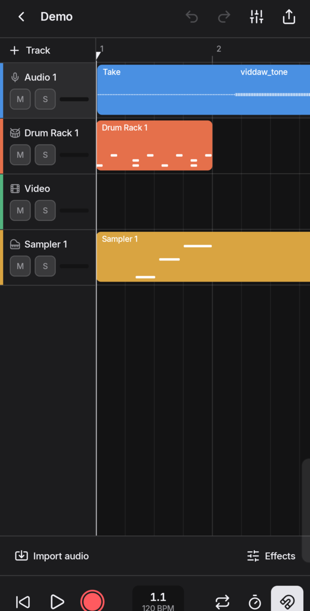
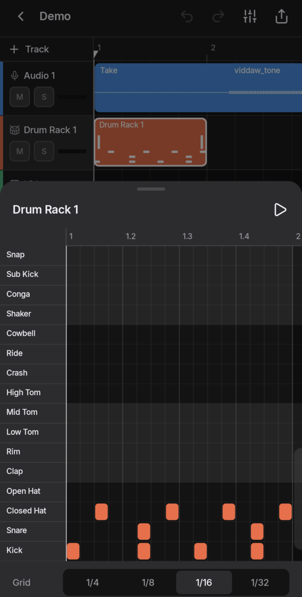
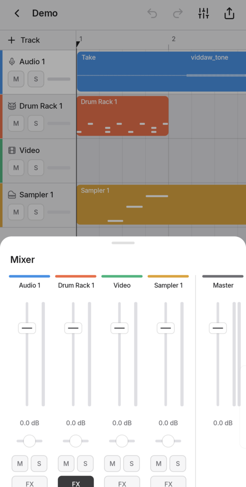

<p align="center"></p>

# Viddaw

A DAW-style audio and video editor for Android. Tracks, clips and a timeline like a music
workstation, with video tracks next to the audio ones. Everything runs on the device:
no account, no cloud, no ads, no tracking.

<p align="center">
  
  
  
</p>

## Features

- Audio tracks: record from the microphone, import any audio or video file the device can decode
- Timeline editing: move, trim, split and duplicate clips, snap to grid, loop region, undo and redo
- Mixer with volume, pan, mute, solo and level meters per track and for the master
- 13 effects per track chain: EQ, compressor, limiter, gate, reverb, delay, chorus, flanger,
  phaser, filter, distortion, stereo width, de-esser
- Sampler and 16-pad drum rack with MIDI clips, piano roll, step grid, on-screen pads and keys
- USB MIDI keyboards work when plugged in, Bluetooth MIDI through Settings
- Video tracks: import clips, edit them like audio, preview in sync, export MP4
- Export to WAV (24 bit), FLAC, M4A (AAC) and MP4
- Light, dark and system theme; English and German

## Install

Download the APK from [Releases](https://github.com/corixien/viddaw/releases) and open it on
the phone. Android 9 or newer.

## Build

Requirements: JDK 17 or newer, Android SDK with platform 37, NDK 29.0.14206865 and CMake 3.31.6.

```bash
./gradlew :androidApp:assembleDebug
```

```bash
adb install -r androidApp/build/outputs/apk/debug/androidApp-debug.apk
```

Tests:

```bash
./gradlew :shared:jvmTest
```

```bash
g++ -std=c++20 -O2 -Iengine/core engine/core/*.cpp engine/tests/tests.cpp -o /tmp/engine_tests -lpthread && /tmp/engine_tests
```

Release builds are signed when `~/.config/viddaw/keystore.properties` exists with
`storeFile`, `storePassword`, `keyAlias` and `keyPassword`. The keystore never goes into the repo.

## How it is built

| Part | Path | What it does |
|---|---|---|
| Engine | `engine/core` | Portable C++20 mixing engine: clip playback, effects, sampler, drum rack, recording, offline render. No platform code. |
| Android binding | `engine/android` | Oboe audio streams and the JNI surface |
| Shared | `shared` | Kotlin Multiplatform: project model, edit functions, app state and the whole Compose UI |
| Android app | `androidApp` | Activity, file pickers, media decoding and encoding, MIDI, Media3 video |

The UI holds the project as immutable data. Every edit produces a new project, which is saved
and handed to the engine as a text snapshot; the engine swaps it in without blocking the audio
thread. Timeline positions are in ticks so they follow the tempo, audio lengths are in frames
at 48 kHz. All project audio is stored as 32-bit float WAV and memory-mapped for playback.

The shared module also compiles for the JVM, which keeps it free of Android code for the
planned desktop and web versions.

## Roadmap

- Time-stretch and pitch-shift for audio clips
- Tempo-synced delay, automation, input monitoring
- Desktop (Windows, Linux) and web builds on the same engine and UI
- More video: transitions between tracks, titles, speed

## License

Apache License 2.0, see [LICENSE](LICENSE). Third-party components are listed in
[THIRD_PARTY_NOTICES.md](THIRD_PARTY_NOTICES.md). The built-in drum kit and sampler tone are
synthesised by the engine; the app ships no third-party samples.
